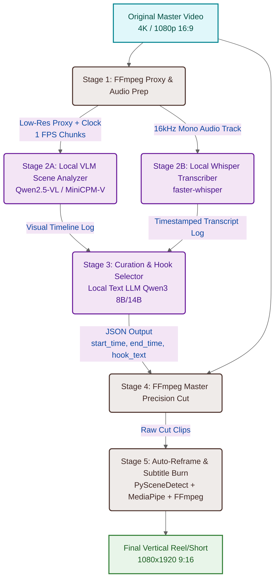

# Reframe AI v2

## High Level Diagram


## Low Level Diagram

```mermaid
flowchart TD
    %% Input
    RAW[("Raw Travel Video\n(travel_vlog_4k.mp4 | 16:9)")]

    %% Stage 1
    subgraph S1 ["Stage 1: FFmpeg Pre-Processing"]
        direction TB
        P1["Generate Low-Res Proxy Chunks\n• 480p @ 1 FPS\n• Burn-in %{pts:hms} clock\n• 3-min segments (-reset_timestamps 0)"]
        P2["Extract Mono Audio\n• 16kHz PCM WAV (audio.wav)"]
    end

    RAW --> P1
    RAW --> P2

    %% Stage 2
    subgraph S2 ["Stage 2: Parallel Local Multimodal Extraction"]
        direction LR
        subgraph S2A ["2A. Visual Scene Logging"]
            VLM["Local VLM (Ollama / llama.cpp)\n• Qwen3-VL / Qwen2.5-VL (7B/8B)\n• MiniCPM-V 4.7 (1.3B)"]
            VLOG["Visual Event Log\n[HH:MM:SS] Drone reveal / Street food"]
            VLM --> VLOG
        end
        subgraph S2B ["2B. Speech & Audio Logging"]
            WHISP["faster-whisper (Local)\n• large-v3-turbo / medium"]
            TLOG["Timestamped Transcript\n[HH:MM:SS] Spoken dialogue + pauses"]
            WHISP --> TLOG
        end
    end

    P1 -->|proxy_chunk_%03d.mp4| VLM
    P2 -->|audio.wav| WHISP

    %% Memory Swap Note
    MEM(["RAM/VRAM Management\nUnload VLM (keep_alive: 0)\nbefore loading Stage 3 LLM"])
    VLOG -.-> MEM
    TLOG -.-> MEM

    %% Stage 3
    subgraph S3 ["Stage 3: Narrative Curation & Hook Selection"]
        direction TB
        MERGE["Merge Logs Chronologically\nUnified [HH:MM:SS] [VISUAL] + [AUDIO] timeline"]
        LLM["Local Reasoning Text LLM\n• Qwen3 (8B/14B) / Gemma 3 (12B) / Llama 3.1 (8B)\n• Enforced Structured JSON Output"]
        JSON[("Curated Segments JSON\n[{start, end, hook_text, clip_type}]")]
        MERGE --> LLM --> JSON
    end

    MEM --> MERGE

    %% Stage 4
    subgraph S4 ["Stage 4: FFmpeg High-Res Master Extraction"]
        TRIM["Lossless / Fast Master Slice\nffmpeg -ss {start} -to {end} -i travel_vlog_4k.mp4\n-c:v libx264 -crf 18 -c:a aac"]
        CLIP[("Raw Horizontal Clips\n(raw_clip_01.mp4 | 16:9)")]
        TRIM --> CLIP
    end

    JSON -->|Timestamps| TRIM
    RAW ==>|Original 4K Source| TRIM

    %% Stage 5
    subgraph S5 ["Stage 5: Automated 9:16 Reframing & Polish"]
        direction TB
        SCENE["PySceneDetect\nSplit clip at hard camera cuts"]
        TRACK{"Shot Subject\nDetection"}
        FACE["Speaker Shot (MediaPipe)\nDynamic X-offset face tracking"]
        BROLL["Scenery / Food B-Roll\nCenter or Saliency crop"]
        RENDER["FFmpeg Final Render\n• crop=ih*(9/16):ih:{x}:0\n• scale=1080:1920\n• Burn subtitles (.srt) + Hook overlay"]

        SCENE --> TRACK
        TRACK -->|Face Found| FACE --> RENDER
        TRACK -->|No Face| BROLL --> RENDER
    end

    CLIP --> SCENE
    JSON -.->|hook_text| RENDER

    %% Output
    OUT[("Final Vertical Videos\n(final_short_01.mp4 | 1080x1920 | 9:16)")]
    RENDER --> OUT

    %% Styling
    style RAW fill:#1e293b,stroke:#38bdf8,stroke-width:2px,color:#fff
    style OUT fill:#065f46,stroke:#34d399,stroke-width:2px,color:#fff
    style MEM fill:#451a03,stroke:#f59e0b,stroke-dasharray: 5 5,color:#fde68a
    style JSON fill:#1e1b4b,stroke:#818cf8,color:#e0e7ff
```



### Important Points
- stage 1: ffmpeg command to downscale video and cut it to segments:
```bash
ffmpeg -i input.mp4 -vf 'fps=1,scale=-2:480,drawtext=text=\'%{pts\:hms}\':x=10:y=10:fontsize=24:box=1' -f segment -segment_time 180 -reset_timestamps 0 proxy_%03d.mp4
```
- stage 1: ffmpeg command to extract audio:
```bash
ffmpeg -i input.mp4 -vn -acodec pcm_s16le -ar 16000 -ac 1 audio.wav
```

- stage 3: structured JSON output:
```json
{'start': '00:01:10',    'end': '00:01:45',    'title': 'Best Street Food Hook'}
```
- stage 4: FFMPEG lossless cutter command:
```bash
fmpeg -ss 00:01:10 -to 00:01:45 -i master.mp4 -c:v libx264 -crf 18 raw_clip.mp4
```
- stage 5: how to handle B roll:
```bash
B-Roll/Scenery -> Saliency Saliency Matrix / Static Box Crop
```

- stage 5: final FFMPEG compositor:
```bash
ffmpeg -i raw_clip.mp4 -vf 'crop=ih*(9/16):ih,scale=1080:1920,subtitles=subs.srt' final_short.mp4
```